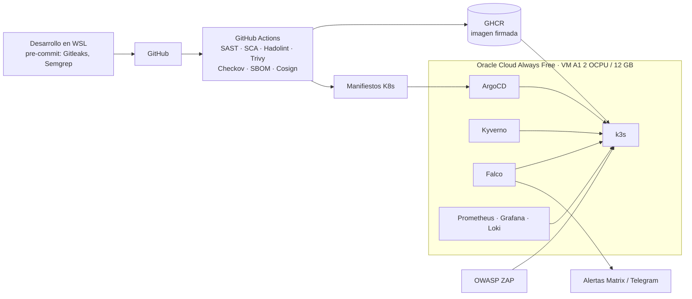

# MyOwnPipeline

Laboratorio personal de **DevSecOps** de extremo a extremo con coste **0 €**: una aplicación sencilla recorre un pipeline CI/CD con controles de seguridad en cada etapa y se despliega mediante GitOps en un clúster Kubernetes endurecido, alojado en Oracle Cloud Always Free.

> El día a día del proyecto (decisiones, problemas y aprendizajes) está en el **[cuaderno de bitácora](docs/BITACORA.md)**.

## Objetivo

- **Shift-left**: detectar secretos, vulnerabilidades y malas configuraciones antes de producción.
- **Cadena de suministro**: SBOM e imágenes firmadas y verificadas antes de desplegarse.
- **Infraestructura como código** escaneada y reproducible.
- **Runtime**: políticas de admisión, detección de comportamiento anómalo y alertas.

## Arquitectura

## Stack

| Capa | Herramientas |
|---|---|
| Infraestructura | Oracle Cloud Always Free (Ampere A1), Terraform, cloud-init, Ansible |
| Sistema operativo | Ubuntu 24.04 Minimal aarch64, hardening CIS, auditd, fail2ban |
| CI/CD | GitHub Actions, GHCR |
| Seguridad en CI | Gitleaks, Semgrep, OSV-Scanner / Trivy, Hadolint, Checkov, Syft, Cosign |
| Despliegue | k3s, ArgoCD (GitOps) |
| Políticas y runtime | Kyverno, Falco, kube-bench |
| Secretos | SOPS + age / Sealed Secrets |
| DAST | OWASP ZAP |
| Observabilidad | Prometheus, Grafana, Loki |

## Progreso

| Fase | Contenido | Estado |
|---|---|---|
| 0 | Planificación, cuenta OCI, entorno WSL, cloud-init de bootstrap | En curso |
| 1 | App + Dockerfile + pipeline con SAST, SCA, Trivy y Gitleaks | Pendiente |
| 2 | Terraform + Ansible + hardening de la VM + k3s | Pendiente |
| 3 | ArgoCD + Cosign + Kyverno verificando firmas | Pendiente |
| 4 | SOPS, ZAP, Falco con alertas, observabilidad | Pendiente |
| 5 | Documentación final, diagrama y modelo de amenazas STRIDE | Pendiente |

## Coste

- **Oracle Cloud Always Free**: 2 OCPU y 12 GB Ampere A1, 200 GB de bloque y 10 TB/mes de salida ([Oracle](https://docs.oracle.com/iaas/Content/FreeTier/freetier_topic-Always_Free_Resources.htm)).
- **GitHub Actions**: gratuito con runners estándar en repositorios públicos ([GitHub](https://docs.github.com/en/billing/concepts/product-billing/github-actions)).
- **GHCR** para imágenes públicas.

## Licencia

[Apache-2.0](LICENSE)
